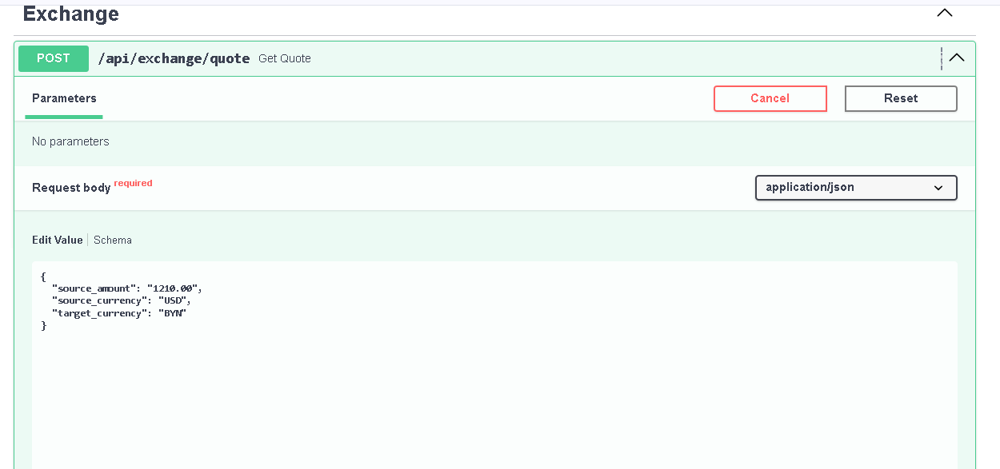
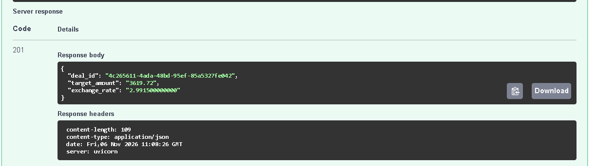
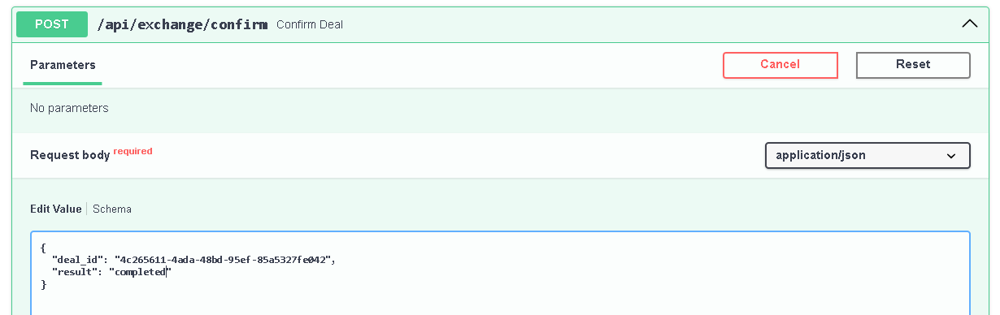
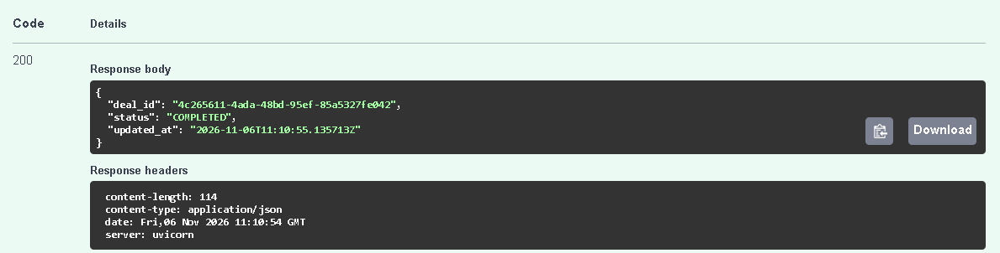
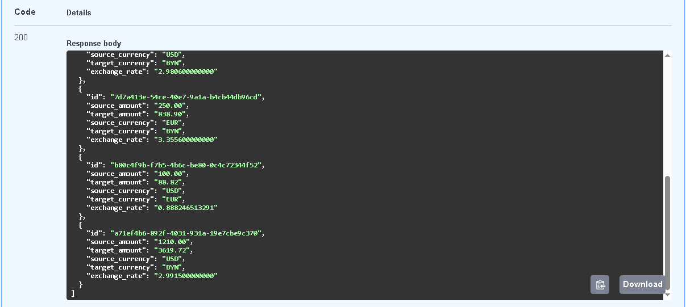
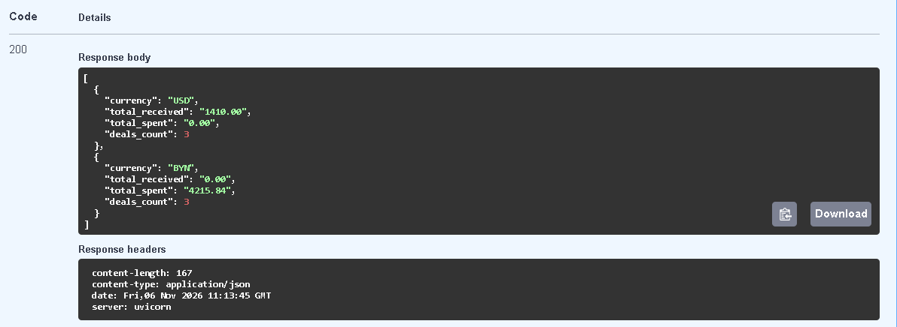

# Развертывание сервиса

Сервис использует постгрю 16. Данные хранятся в докер volume `pg_data`.

# Команды для запуска сервиса
```bash
git clone https://github.com/fedyaslonn/erip-tz.git
docker compose -f erip-tz/docker-compose.yml up --build 
```

# Дока по эндпоинтам

# /api/exchange/quote
Создает ожидаемую сделку, возвращая id сделки для ее последующего подтверждения.




# /api/exchange/confirm
Апрувает сделку или реджектит.




# /api/exchange/pending
Получить список сделок в ожидании.



# /api/exchange/stats
Просмотреть статистику по сделкам (за какой-то период)


